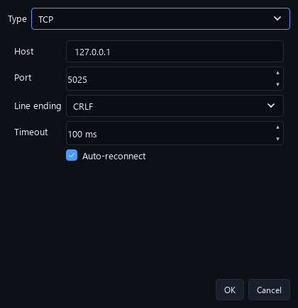
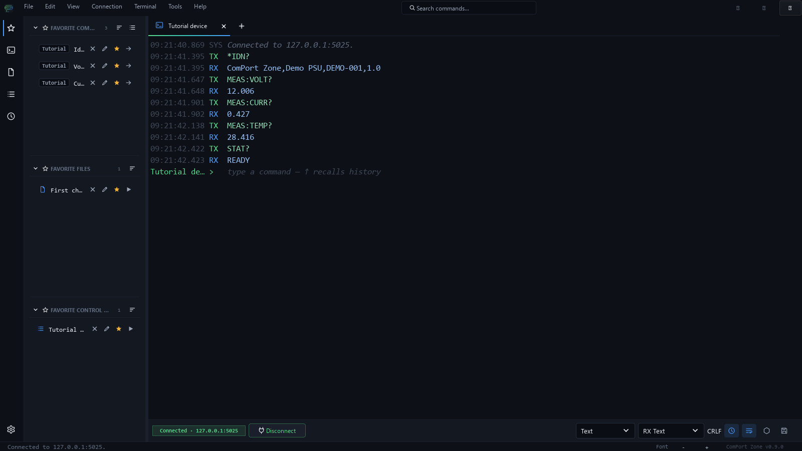
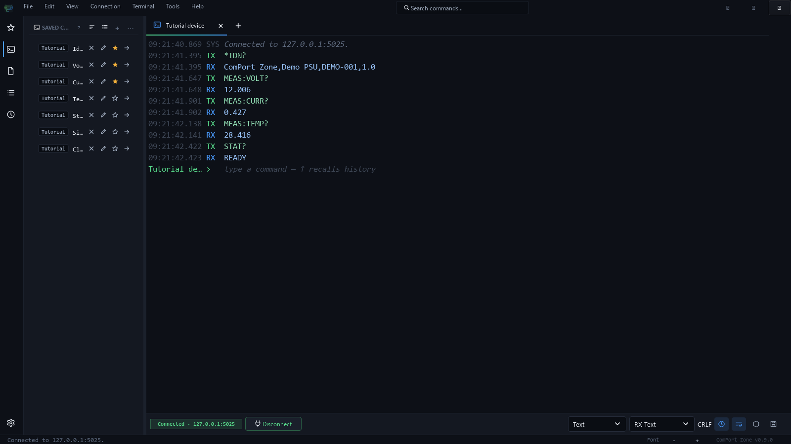
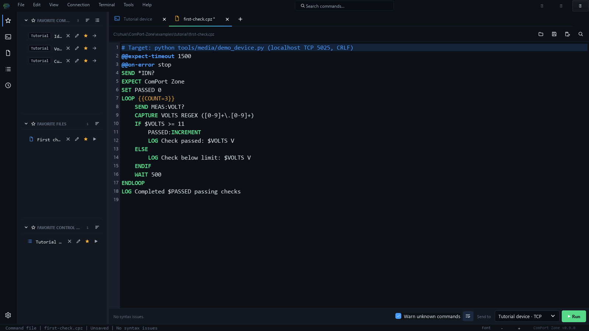
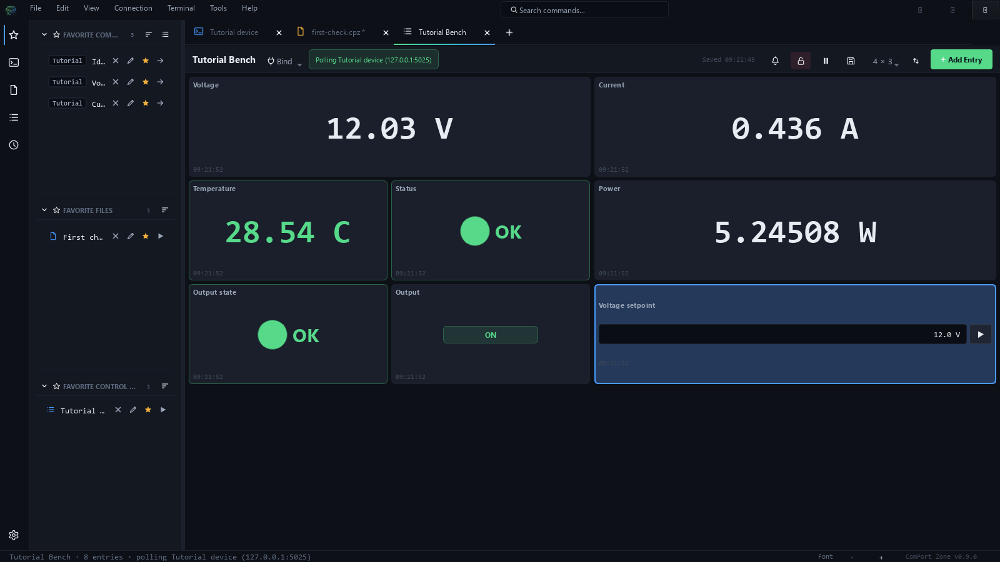
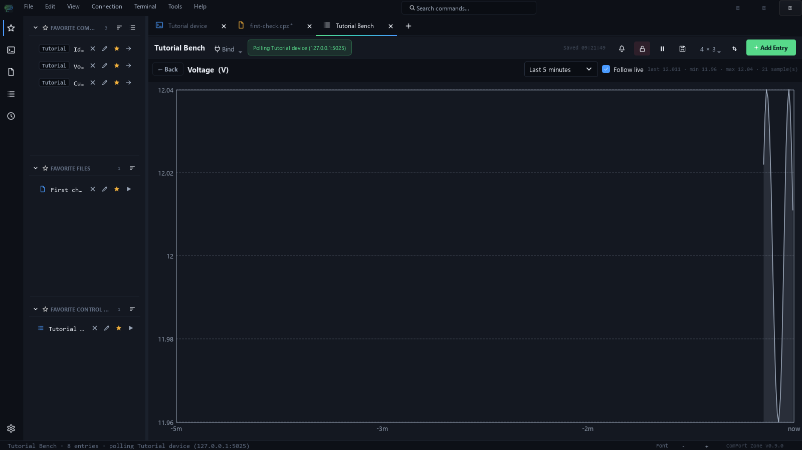
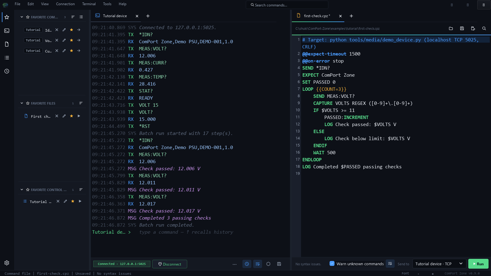

# ComPort Zone User Manual

**English edition | ComPort Zone 0.9.0 | Reviewed 2026-11-03**

ComPort Zone is a Windows terminal and automation workbench for serial devices,
TCP endpoints, and UDP endpoints. Use it to inspect a device, keep useful
commands, repeat checks, and monitor measurements in a Control Panel. The desktop
application and command-line interface share settings and command files.

Start with the first-session tutorial below. It uses a simulated instrument on
your own PC, so you can follow it without a COM port or physical device.

The [narrated tutorial](https://github.com/shuky-shukrun/ComPort-Zone/releases/latest),
[captions](media/comport-zone-walkthrough.srt), and
[printable manual](https://github.com/shuky-shukrun/ComPort-Zone/releases/latest/download/comport-zone-user-manual.pdf)
accompany this guide. Release notes identify the recording's version; a release
can reuse an earlier walkthrough when its demonstrated workflows are unchanged.

## Contents

1. [Install and launch](#1-install-and-launch)
2. [Your first session, without hardware](#2-your-first-session-without-hardware)
3. [Connect to your own device](#3-connect-to-your-own-device)
4. [Work in the terminal](#4-work-in-the-terminal)
5. [Save commands and files](#5-save-commands-and-files)
6. [Automate a check](#6-automate-a-check)
7. [Monitor and control with a Control Panel](#7-monitor-and-control-with-a-control-panel)
8. [Arrange your workspace](#8-arrange-your-workspace)
9. [Use the command line](#9-use-the-command-line)
10. [Settings, backups, and sharing](#10-settings-backups-and-sharing)
11. [Troubleshooting](#11-troubleshooting)
12. [Keyboard reference](#12-keyboard-reference)

## 1. Install and launch

Download the Windows installer or portable ZIP from the project's
[Releases page](https://github.com/shuky-shukrun/ComPort-Zone/releases).
The installer filename follows `ComPort_Zone-X.Y.Z-win64-setup.exe`.
Run it and follow its prompts. For the portable edition, extract the entire ZIP
to a writable folder, keeping the application and its bundled files together.
Launch the ComPort Zone executable in that folder.

The packaged application includes its Python runtime. You do not need to install
Python to use the desktop app. Running the optional tutorial device from source
does require Python, as described in the next chapter.

To upgrade, close the app and run the newer installer. Settings are kept in your
Windows user profile. Make an export before moving to another PC or changing
versions. The portable app also uses the normal per-user settings location.

For a source checkout, install Python 3.12 or newer and run these commands from
the repository folder in PowerShell:

```powershell
.\setup_dev.bat
.\launch_app.bat
```

The setup script creates the development environment and installs dependencies.
The release number in this manual identifies the interface used for its images.

## 2. Your first session, without hardware

### Prepare the tutorial device

Download or clone the source repository. In PowerShell, change to its folder and
start the demonstration instrument:

```powershell
python tools/media/demo_device.py
```

This script needs only Python's standard library. It prints
`Tutorial device: TCP + UDP 127.0.0.1:5025`. Leave that terminal open.
The device listens only on localhost. Its measurements are simulated.
Stop it with **Ctrl+C** when you finish. If port 5025 is in use, start it with
`--port 5026` and use that port in the application and CLI examples.

### Connect and identify

1. Launch ComPort Zone. Create a terminal tab with **Ctrl+T** if needed.
2. Open **Connection Settings** for the tab.
3. Choose **TCP**, host **127.0.0.1**, port **5025**, and line ending **CRLF**.
4. Accept the dialog and connect. The connection indicator should become green.
5. Click the terminal's **TX>** prompt, type `*IDN?`, and press **Enter**.

You should receive `ComPort Zone,Demo PSU,DEMO-001,1.0` in an RX row.
The `*IDN?` text is a device command, not a ComPort Zone keyword.



### Read measurements

Send each query separately:

```text
MEAS:VOLT?
MEAS:CURR?
MEAS:TEMP?
STAT?
```

Expect a voltage near 12 V, current near 0.42 A, temperature near 28 C, and
`READY`. Measurements change slightly with each sample. The demonstration
supports both TCP and UDP on the same port; use one terminal initially.



### Understand the window

The workspace holds terminal tabs, command-file editor tabs, and Control Panel
tabs. The left drawer gives access to favorites, saved commands, files,
history, and Control Panels. The terminal shows timestamps, direction, and
messages. The integrated **TX>** line is where you compose the next command.
The footer reports connection and workspace state.

## 3. Connect to your own device

Create a separate terminal tab for each independent connection. Open the tab's
Connection Settings and select the appropriate transport.

| Transport | Settings to obtain from your device documentation |
| --- | --- |
| Serial | COM port, baud rate, data bits, parity, stop bits, flow control, line ending |
| TCP | Host/IP address, TCP port, line ending, connection timeout |
| UDP | Host/IP address, UDP port, line ending, reply timeout |

For serial, connect the USB-to-serial adapter or device and select its COM port.
Match the firmware's settings; for example, 115200 baud and 8-N-1 is common but
is not universal. Enable hardware flow control only when the device and cable
support it. DTR and RTS affect physical control lines and can reset some boards;
choose them according to the device's requirements.

For TCP, use the device's raw socket endpoint. A web browser address is not
necessarily a raw TCP command endpoint. For UDP, a green indicator means the
local socket is available; UDP does not establish a connection with the remote
device. A reply is needed to establish that your target actually answers.

**Ctrl+Enter** connects or disconnects the current terminal. Serial and TCP
support auto-reconnect. UDP is connectionless and has no auto-reconnect cycle.
Connect settings belong to each terminal tab, so always check the active tab
before sending a command.

## 4. Work in the terminal

### Compose, send, and recall

Type after **TX>** and press **Enter**. Use **Shift+Enter** to add another draft
line. The committed transcript remains above your editable draft. The **Up**
and **Down** arrows recall command history. **Ctrl+Space** offers completions
from history and saved commands.

For the tutorial, send `VOLT 15` followed by `VOLT?`. The write produces no
reply; the query returns `15.000`. A silent write can be normal. Confirm changes
using the device's query command rather than assuming every send gets an answer.
Send `*RST` to restore the demo's defaults.

### Text, hexadecimal, and line endings

Text mode sends encoded text with the selected line ending. CR, LF, and CRLF
are different byte sequences; match your target's protocol. **Hex Bytes** sends
the bytes you enter, without adding a text line ending. For example, to send
`ping` plus CRLF as raw bytes to the tutorial device, use:

```text
70 69 6E 67 0D 0A
```

The response should be `PONG`. Return to text mode afterward. Receive display
mode changes how bytes appear; it does not change the bytes transmitted.

### Search, pause, and logging

Use **Ctrl+F** to search the terminal and **Ctrl+K** to clear its display.
Timestamp and line-wrap actions are in **View**. Adjust terminal text size with
**Ctrl + mouse wheel**, **Ctrl+=**, or **Ctrl+-**.

Terminal receive pause and command-file pause serve different purposes. Receive
pause holds presentation of incoming traffic; it does not disconnect the device.
Command-file pause suspends further script steps. Resume the relevant control
to continue. A device can keep sending while its displayed traffic is paused.

Start terminal logging from the terminal's logging control and choose a file.
Confirm that the status shows logging enabled. Stop logging before moving the
file. Terminal traffic logs and Control Panel CSV value logs serve different
purposes: one records communication, the other records parsed measurements.

## 5. Save commands and files

Open the drawer with **Ctrl+B**. Select **Saved Commands**, add a command, and
give it a label and group. For example, label `Identify`, command `*IDN?`, group
`Tutorial`, send mode `Text`. Star it to place it in **Favorites**.

Select the command and use its send action. Check the active terminal first.
History entries can also be sent again or promoted to saved commands. A saved
command's send mode is part of its definition; raw hex commands should remain
in Hex Bytes mode when shared.



To import the prepared library, choose **Tools > Import Saved Commands (CSV)...**
and select `examples/tutorial/quick-commands.csv`. Review the import options,
including append/replace and duplicate handling. Export from the matching CSV
action when sharing your library.

The **Files** page stores paths to command files. Add
`examples/tutorial/first-check.cpz`, give it a name, and star it if useful.
A saved file entry is a shortcut to a file on disk; move the file and you must
update its path. Exporting quick-file CSV does not copy the scripts themselves.

## 6. Automate a check

### Run the prepared example

1. Keep the tutorial TCP terminal connected.
2. Open `examples/tutorial/first-check.cpz` in the command-file editor.
3. Inspect the script and choose the connected terminal in the editor's run target.
4. Run it. When asked for `COUNT`, keep the default **3**.
5. Look at the terminal output and run status.

The script identifies the instrument, measures voltage three times, checks each
reading, and logs a summary. After `*RST`, expect three passing checks. If output
was switched off, turn it back on with `OUTP ON` before running the example.



### Build a small script

```text
@@expect-timeout 1500
SEND *IDN?
EXPECT ComPort Zone
LOOP {{COUNT=3}}
    SEND MEAS:VOLT?
    CAPTURE VOLTS REGEX ([0-9]+\.[0-9]+)
    LOG Voltage is $VOLTS V
    WAIT 500
ENDLOOP
```

`SEND` transmits text; a bare command line can do the same. `EXPECT` waits for
matching received text. `CAPTURE` saves a regex match into a runtime variable.
`WAIT` uses milliseconds. `{{COUNT=3}}` is a run-time parameter with a default;
`$VOLTS` is a runtime value obtained during this run. They are separate concepts.

The editor provides line numbers, syntax highlighting, completions, validation,
and find/replace. Save before sharing a script. Check both the file and the
selected target whenever several devices are open.

### Control the run

Use **Pause / Resume** to suspend script progress and **Stop** to end the run.
`PAUSE Inspect the board` adds an operator checkpoint; continue with the dialog's
button or Return/Space. `LOOP FOREVER` repeats until stopped, or until a `BREAK`
leaves the loop. `IF`/`ELSE` selects a branch. `SET`, `NAME:INCREMENT`, and
`NAME:DECREMENT` manage values local to one run. `HEX` sends raw bytes.

By default, an unmet response check stops the run. `@@expect-timeout` changes the
wait; `@@on-error continue` deliberately permits the run to continue after a
failed step. Use that option only when continuing is appropriate to your check.
See [Command-file scripting](COMMAND_FILES.md) for the full language and examples.

## 7. Monitor and control with a Control Panel

### Import the tutorial panel

1. Open the Control Panel manager with **Ctrl+Shift+D**.
2. Use its JSON import action and select `examples/tutorial/control-panel.json`.
3. Open **Tutorial Bench**.
4. Bind it to the connected tutorial terminal using the panel's binding control.

You should see voltage, current, temperature, status, computed power, output
state, an output toggle, and a voltage setpoint. With one eligible connection
the panel may bind automatically. Confirm the binding chip identifies the
correct terminal. Polling shares that terminal's connection.



### Configure a measurement

Add a value tile with label `Voltage`, command `MEAS:VOLT?`, unit `V`, numeric
parsing of the first line, interval **500 ms**, and timeout **300 ms** for the
local demo. Use a longer timeout and a suitable interval for slower real devices.
Choose regex parsing when the reply includes a label or other text around the
number. Test the command manually first so you know the actual reply format.

Rules are evaluated in order. The tutorial's temperature tile turns FAIL above
50 C. A computed tile can combine named numeric tiles, for example
`{Voltage} * {Current}` for power. Keep referenced labels recognizable.

LED tiles show states; bit-field tiles can present individual flags in integer
status replies. Buttons and toggles send commands. Setpoint tiles send a numeric
value through a template. Enum tiles offer named choices. Configure readback
so indicators reflect the device's reported state.

### Charts, alerts, and CSV

Enable a numeric tile's sparkline to see recent history. Double-click it to open
the larger chart. Choose the time span and inspect points with the hover cursor.
New panels need time to collect history; chart data is session history rather
than a replacement for a persistent log.



To demonstrate an alert, send `DEMO:FAULT ON` in the tutorial terminal. Status
changes to `FAULT`, temperature rises above the threshold, and FAIL transitions
appear in the panel's alert history. Send `DEMO:FAULT OFF` to recover. Alert sounds
can be controlled globally and per tile. Acknowledging an alert does not change
the device state.

Choose a CSV path and enable the panel's CSV logging to record parsed values.
Rows distinguish polls, derived values, and control sends with a `kind` column.
Keep the application open and the machine awake for an unattended run.

### Master Arm and connection sharing

The panel starts **disarmed**. Enable **Master Arm** before using writing tiles;
press **Esc** to disarm immediately. Disarming blocks further panel writes. It
does not send a device shutdown command or undo previous commands. Terminal and
script sends have their own workflows, so Master Arm is not a global write lock.

In the demo, arm the panel, change the voltage setpoint, and confirm the measured
voltage changes. Try the output toggle and observe output state. Disarm when done.

Background polls do not fill the terminal transcript. They pause for a
disconnected target or a command-file run, then resume when available again.
Check the binding/status chip when values stop updating. Advanced panels may
target different open sessions per entry; verify each target when sharing one.

## 8. Arrange your workspace

Use **Ctrl+T** for another terminal and **Ctrl+Shift+T** to duplicate a terminal's
configuration. A separate connection may still be refused when another tab or
program owns the COM port. Rename tabs to identify the connected equipment.

Split the active tab to the right with **Ctrl+\\**, or use the split actions in
the tab's context menu. Keep a terminal beside the script editor or compare two
devices. Join panes when you want one tab area again. The app restores the
workspace layout and tab state through its settings.



**Ctrl+Shift+P** opens the command palette. Type an action name such as
`connect`, `theme`, or `settings`, then choose the result. Use Preferences and
the View menu to choose a theme, terminal font, wrapping, and timestamps.

## 9. Use the command line

The examples below assume the `comport-zone` command is available. In a source
checkout, activate `.venv\Scripts\Activate.ps1` after setup, or replace
`comport-zone` with `.\.venv\Scripts\python.exe -m ComPort_Zone`.
Keep the tutorial device running in another terminal.

```powershell
comport-zone send "*IDN?" --host 127.0.0.1 `
  --tcp-port 5025 --line-ending CRLF --read-after 500
comport-zone validate examples/tutorial/first-check.cpz
comport-zone run examples/tutorial/first-check.cpz `
  --host 127.0.0.1 --tcp-port 5025 --line-ending CRLF `
  --param COUNT=3 --non-interactive
comport-zone send ping --udp-host 127.0.0.1 --udp-port 5025 --expect PONG
```

Serial commands use `--port COM6 --baud 115200` instead of network flags.
`ports list` discovers serial ports; `listen` receives traffic; `repl` opens an
interactive session. Use `--config PATH` before the subcommand to choose a
separate settings file when experimenting. Without it, GUI and CLI use the
same per-user configuration.

For automation, check the process exit code: **0** means success; **11** means
an EXPECT/response-check failure; **12** means a missing parameter; **13** means
a command-file parse error. Use `--non-interactive` and provide required
parameters in unattended runs. Avoid opening a COM port in both GUI and CLI
simultaneously. See the [CLI reference](CLI_REFERENCE.md) for all flags and codes.

## 10. Settings, backups, and sharing

The default settings file is:

```text
%LOCALAPPDATA%\ComPortZone\settings.json
```

The app writes settings atomically and maintains a `.bak` recovery candidate.
Settings include connection defaults, tabs, layout, history, theme, and fonts.
Use the application export actions instead of hand-editing a file while the
application is running.

| What you want to share | Export or copy |
| --- | --- |
| Application preferences/workspace | File > App Settings Import / Export, JSON |
| Saved commands | Saved-command CSV export |
| Saved file shortcuts | Quick-file CSV export, plus the actual files |
| A runnable check | The `.cpz` file and a description of its target |
| A Control Panel | Control Panel manager JSON export |
| Captured communication | Terminal log file |
| Measurement history | Control Panel CSV log |

App-settings transfer intentionally excludes the quick-action libraries, which
have their own CSV transfer. A JSON panel definition does not itself create a
physical connection; bind it to the intended terminal after importing. Older
builds may reject settings or panels that require newer features; use a matching
or newer release rather than stripping version fields.

## 11. Troubleshooting

| Symptom | Check and next action |
| --- | --- |
| No COM port is listed | Check USB cable, power, adapter driver, and Windows Device Manager; refresh the list |
| Port busy or access denied | Disconnect other tabs and close other programs that own the port |
| Connected, but no reply | Verify endpoint, device command, line ending, flow control, and firmware state; some writes are intentionally silent |
| Garbled serial text | Match baud, data bits, parity, stop bits, and the device's encoding |
| TCP connection refused | Start the target server and confirm its host/port; for this tutorial, keep demo_device.py running |
| UDP is green but nothing answers | Confirm target address, port, datagram format, and reply support; UDP has no remote handshake |
| Raw hex command gets no reply | Include any required framing/terminator bytes; Hex Bytes adds no text line ending |
| EXPECT or CAPTURE fails | Inspect actual RX text, regex and timing; increase the response timeout if warranted |
| A script asks for parameters | Supply each `{{NAME}}`; for CLI, use `--param NAME=VALUE` |
| Panel is unbound or paused | Bind the intended terminal, connect it, resume polling, or finish the command-file run |
| A tile reports a parse error | Send its query manually and match the numeric/regex parse rule to the actual reply |
| Writable tile does nothing | Check Master Arm, target health, valid range/choice, and the tile's readback configuration |
| A saved file cannot be opened | Update its shortcut after moving the file, or copy the actual script to this machine |

For a reproducible report, record the app version, transport, connection
settings, exact command, expected reply, actual output, and a minimal script.

## 12. Keyboard reference

| Shortcut | Action |
| --- | --- |
| Ctrl+T / Ctrl+Shift+T / Ctrl+W | New / duplicate / close tab |
| Ctrl+Enter | Connect or disconnect |
| Enter / Shift+Enter | Send draft / insert draft newline |
| Up / Down | Recall history |
| Ctrl+Space | Command completion |
| Ctrl+B | Toggle drawer |
| Ctrl+F / Ctrl+K | Search / clear terminal |
| Ctrl+Shift+P | Command palette |
| Ctrl+\\ | Split tab right |
| Ctrl+R / Ctrl+. | Run / stop command file |
| Ctrl+Shift+D | Control Panel manager |
| Esc in a Control Panel | Disarm writing tiles |

The [command-file guide](COMMAND_FILES.md) and [CLI reference](CLI_REFERENCE.md)
provide the detailed syntax behind the workflows demonstrated here.
